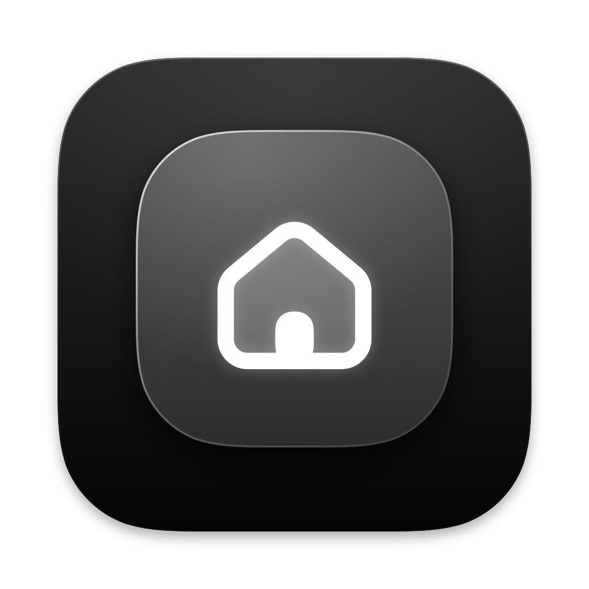
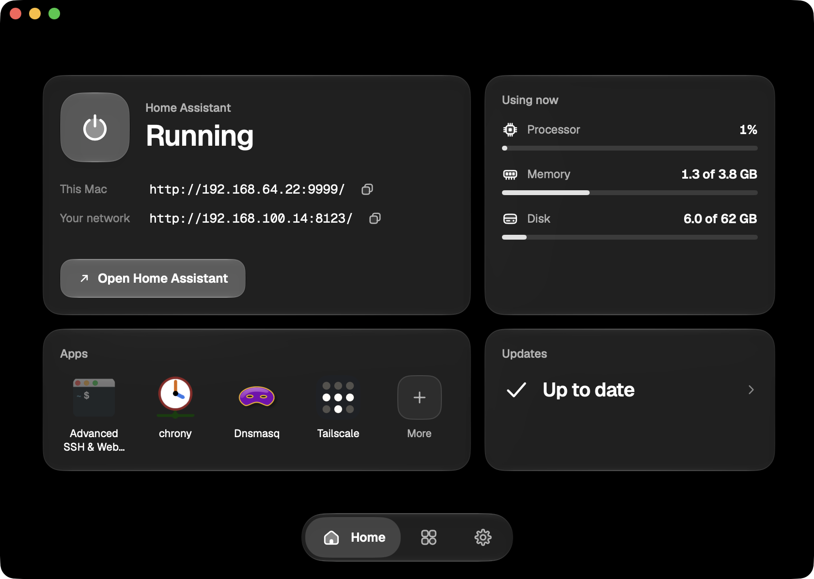
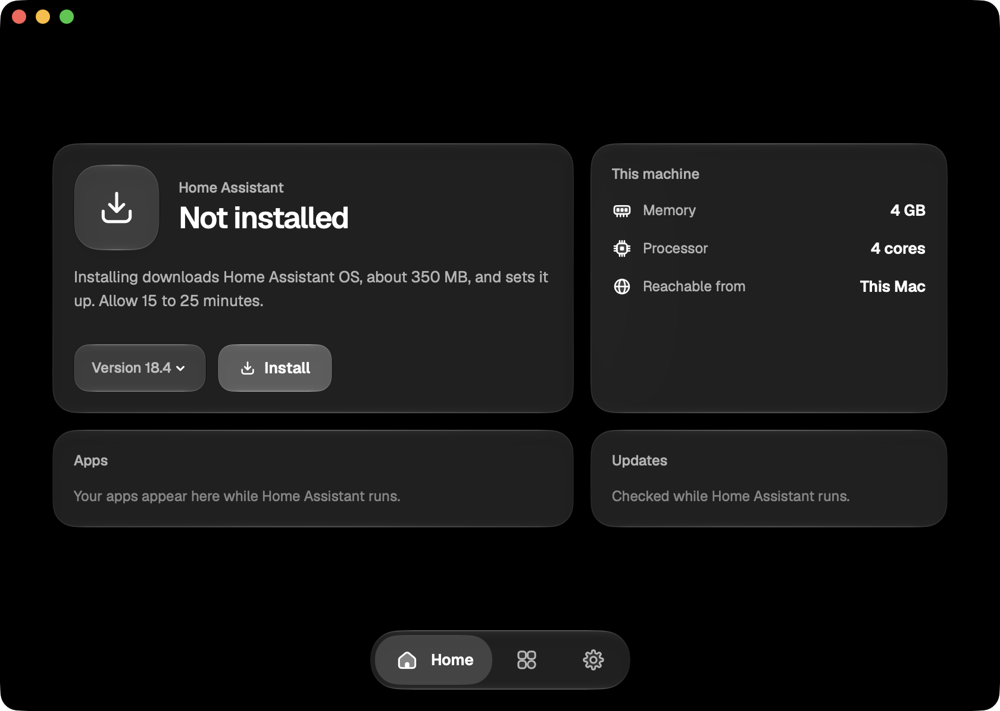
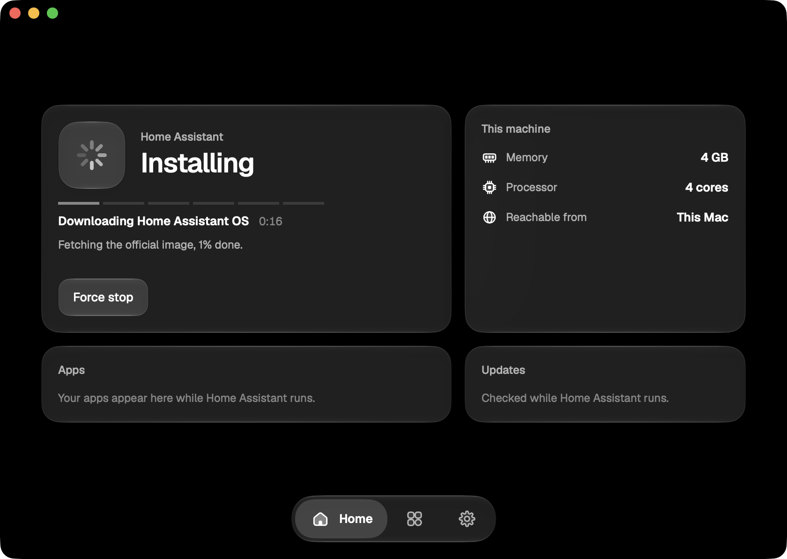
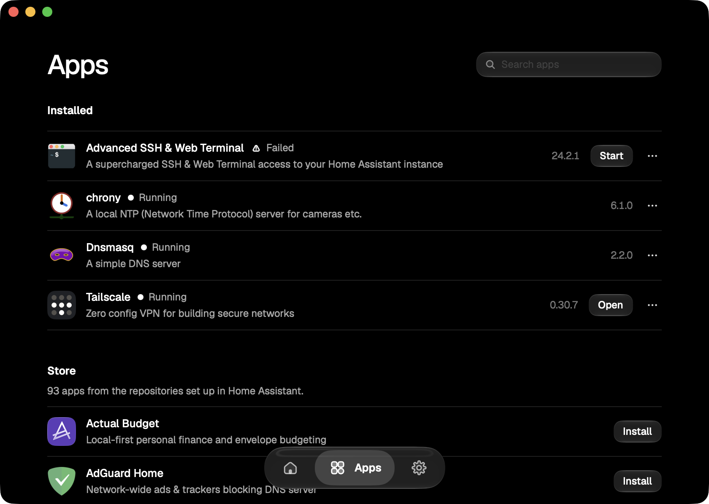
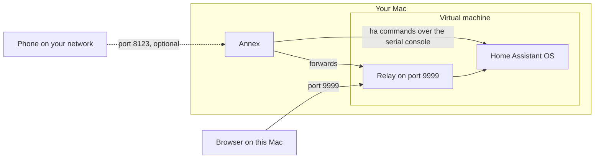

<p align="center">
  
</p>

<h1 align="center">Annex</h1>

<p align="center">Home Assistant OS on your Mac, in one native app.</p>

<p align="center">
  
</p>

Annex runs the full Home Assistant OS on an Apple silicon Mac. It downloads the official image, builds a virtual machine with Apple's own Virtualization framework, and keeps Home Assistant running quietly in the background. You get the same system that runs on a Home Assistant Green or a Raspberry Pi, with Supervisor, apps (formerly add-ons), backups and updates, and you don't need extra hardware, Docker or a third-party hypervisor.

## Highlights

- **One-click install.** Choose a version, press Install, and Annex handles the download, the disk, the first boot and the setup.
- **Native speed.** Home Assistant OS is built for ARM, and so is your Mac. The machine runs on Apple's hypervisor with nothing emulated.
- **Your apps, in the app.** See every installed Home Assistant app with its live state. Start, stop, restart, update, open or uninstall it, and install new ones from the store.
- **Updates and backups.** Update Home Assistant Core, the operating system, Supervisor and apps with one click. Create, restore and delete Home Assistant backups.
- **Disk snapshots.** Save a copy of the whole machine before a risky change and roll back to it later. On APFS a snapshot takes no extra space until the machine changes.
- **Quick resume.** Quitting Annex suspends Home Assistant, and the next launch picks up where it left off in seconds.
- **Reach it from your phone.** Optionally share Home Assistant on your network at `http://<your Mac>:8123/`.
- **Stays out of the way.** Close the window and Home Assistant keeps running from the menu bar. Annex can open at login and notify you when Home Assistant is up.
- **Logs and console.** Read Core, Supervisor, operating system and per-app logs, or use a terminal into the machine.

## Screenshots

| Before installing | Installing |
| :---: | :---: |
|  |  |

<p align="center">
  
</p>

## Requirements

- A Mac with Apple silicon (M1 or later).
- macOS 14 Sonoma or later. On macOS 26 and later the interface uses Liquid Glass.
- 4 GB of memory to give the machine by default (adjustable from 2 to 16 GB).
- A few gigabytes of disk space to start. The machine's disk is a 64 GB sparse file, so it only takes up what Home Assistant actually stores.

## Install

### Download

Download the latest `Annex-<version>.zip` from [Releases](../../releases), unzip it, and move **Annex** to Applications.

Annex is not notarized yet, so macOS blocks it the first time you open it. On macOS 15 and later, open it once, then go to **System Settings > Privacy & Security** and click **Open Anyway**. On macOS 14, right-click the app, choose **Open**, then **Open** again.

### Build from source

You need the Xcode command line tools; Liquid Glass is compiled in with Xcode 26 or later. Clone this repository, then run:

```sh
./build.sh
open ~/Desktop/Annex.app
```

`build.sh` compiles a release build, packages it as `Annex.app` on your Desktop and signs it for your own Mac. Set `ANNEX_APP_PATH` to put the app somewhere else.

## Getting started

1. Open Annex and press **Install**. The menu next to it lets you pick a specific Home Assistant OS version.
2. Wait 15 to 25 minutes. Annex shows each stage as it goes; most of the time is Home Assistant downloading its own components inside the machine.
3. When the state reads **Running**, press **Open Home Assistant** and finish Home Assistant's onboarding in your browser.

From then on:

- **Quit** suspends Home Assistant. The next start resumes it in a few seconds.
- **Stop** shuts Home Assistant down completely. The next start takes about a minute.
- **Closing the window** keeps Home Assistant running from the menu bar.

## How it works

### The real Home Assistant OS

Annex does not repackage or modify Home Assistant. It downloads the official `generic-aarch64` image that the Home Assistant project publishes on GitHub for ARM computers and boots it unchanged. Updates come from Home Assistant itself, the same way they would on dedicated hardware.

### A virtual machine on Apple's hypervisor

macOS has a hypervisor built in, and apps reach it through Apple's Virtualization framework. Annex uses it to create a small computer inside your Mac: 4 processor cores and 4 GB of memory by default, UEFI firmware, a 64 GB disk, a network card and a serial console. Your Mac and the Home Assistant OS image are both ARM64, so the processor runs Home Assistant's code directly, at full speed. The machine lives inside the Annex process; there is no background service, kernel extension or other software to install.



### Networking

The machine sits on a private network that only your Mac can reach, and Annex finds its address in macOS's DHCP records. Home Assistant only accepts its live connection (the WebSocket behind every dashboard) cleanly when it comes from inside its own machine. So on first boot Annex starts a small relay inside Home Assistant OS on port 9999, which hands each browser connection to Home Assistant as a local one. That is why your address ends in `:9999`.

To use Home Assistant from a phone or another computer, turn on **Reach Home Assistant from other devices** in Settings. Annex then forwards port 8123 on your Mac to the machine, so `http://<your Mac's address>:8123/` works anywhere on your network. It is off by default, because while it is on anyone on that network can reach the sign-in page.

### Talking to Home Assistant

Annex manages apps, updates, backups and logs through Home Assistant OS's own `ha` command line, typed over the machine's serial console. It never needs your Home Assistant password or an access token. Each command is wrapped in marker lines so Annex can pick its output out of everything else on the console, and long jobs such as installs run in the background inside the machine while Annex checks on their progress.

### Starting, stopping and resuming

Startup is a sequence of stages: downloading the image, preparing the disk, starting the machine, waiting for its network, waiting for Home Assistant, and connecting the relay. Each stage has a time limit. If one stalls, Annex tells you which stage and for how long, and keeps the console transcript so you can see why.

**Quit** saves the machine's memory to disk and pauses it, and the next launch restores it in a few seconds. **Stop** asks Home Assistant OS to shut down properly, so apps and the database close cleanly before the machine powers off.

### Snapshots

Snapshots are taken while Home Assistant is not running. A snapshot copies the machine's disk and firmware settings, plus its saved memory if it was suspended. On APFS the copy is a clone: it is instant and shares space with the original until one of them changes. A restore swaps the copy in only once it is complete, so a failed restore changes nothing.

## Your data

Annex keeps everything in `~/Library/Application Support/HAOSRunner/`:

| File | What it is |
| --- | --- |
| `haos.img` | The machine's disk |
| `efi-vars.fd` | The machine's firmware settings |
| `machine-state.vzvmsave` | The saved memory of a suspended machine |
| `Snapshots/` | Your disk snapshots |
| `console.log` | A transcript of the machine's console |

`console.log` records everything shown on the console, including commands you type in the Console screen. Avoid typing passwords there (for example with `ha auth reset`), or delete the file afterwards.

**Erase and start over** in Settings deletes the machine and keeps the downloaded image, so a reinstall starts without downloading it again.

## Troubleshooting

**The first start takes a long time.** Before it starts Home Assistant, Supervisor updates itself and its plugins from GitHub's container registry. On a slow route to that registry this can take half an hour, even when the rest of your connection is fast. Annex shows which component is downloading and keeps waiting while the download makes progress.

**The machine starts but shows no boot output.** Three interrupted starts in a row (force stops or crashes) use up Home Assistant OS's boot attempts, and its bootloader stops trying. Annex notices after 90 seconds and offers **Repair startup**, which resets the count. Your Home Assistant data is not touched.

**Installs and updates fail with "system is not healthy - data_filesystem_check_error".** Home Assistant checks its data disk once per boot and refuses changes until a boot where that check completes. Home shows a **Restart now** button, which shuts the machine down cleanly and starts it from cold. Quitting Annex does not help, because quitting suspends Home Assistant rather than restarting it.

**"Give Home Assistant its own address on your network" won't start.** This bridged mode needs Apple's `com.apple.vm.networking` entitlement, which only builds signed by a paid Apple developer account can carry. Use **Reach Home Assistant from other devices** instead.

## Development

Annex is a Swift package with no third-party dependencies.

```sh
swift test      # parsers, the console protocol, the Home Assistant client, snapshots, the port relay
swift build     # debug build
./build.sh      # release build, packaged as Annex.app with the virtualization entitlement
```

| Files | What they do |
| --- | --- |
| `Controller.swift` | Starts, stops and resumes the machine, one stage at a time |
| `VirtualMachine.swift` | The machine's configuration, disk and settings |
| `SerialConsole.swift`, `GuestShell.swift` | The serial console and the command protocol on top of it |
| `Supervisor.swift`, `HomeAssistantStore.swift` | The `ha` client and the app's view of Home Assistant |
| `Snapshots.swift`, `PortForwarder.swift`, `MacIntegration.swift` | Snapshots, network sharing, login item and notifications |
| `*Screen.swift`, `MainWindow.swift`, `Theme.swift`, `Glyphs.swift` | The interface and its icon set |

Every screen can be drawn from sample data, in light and dark, without starting a machine. Liquid Glass is drawn by the window server, so this briefly shows a real window:

```sh
HAOS_SNAPSHOT_DIR=/tmp/annex-screens swift test --filter ScreenRenderTests
```

To run a development copy next to your real one, with its own disk and settings:

```sh
ANNEX_SUPPORT_DIR=/tmp/annex-dev ANNEX_DEFAULTS_SUITE=annex.dev ~/Desktop/Annex.app/Contents/MacOS/Annex
```

The app icon is drawn in code; `swift scripts/makeicon.swift` writes `icon_1024.png` and `AppIcon.icns` from the same vectors. The interface is set in Geist and Geist Mono, and its icons are drawn in code on a 24-point grid.

Issues and pull requests are welcome. Please run `swift test` before opening one.

## License

Annex is released under the [MIT License](LICENSE). Geist and Geist Mono are by Vercel and licensed under the SIL Open Font License (`Resources/Fonts/OFL.txt`).

Annex is an independent project and is not affiliated with Home Assistant or the Open Home Foundation.
